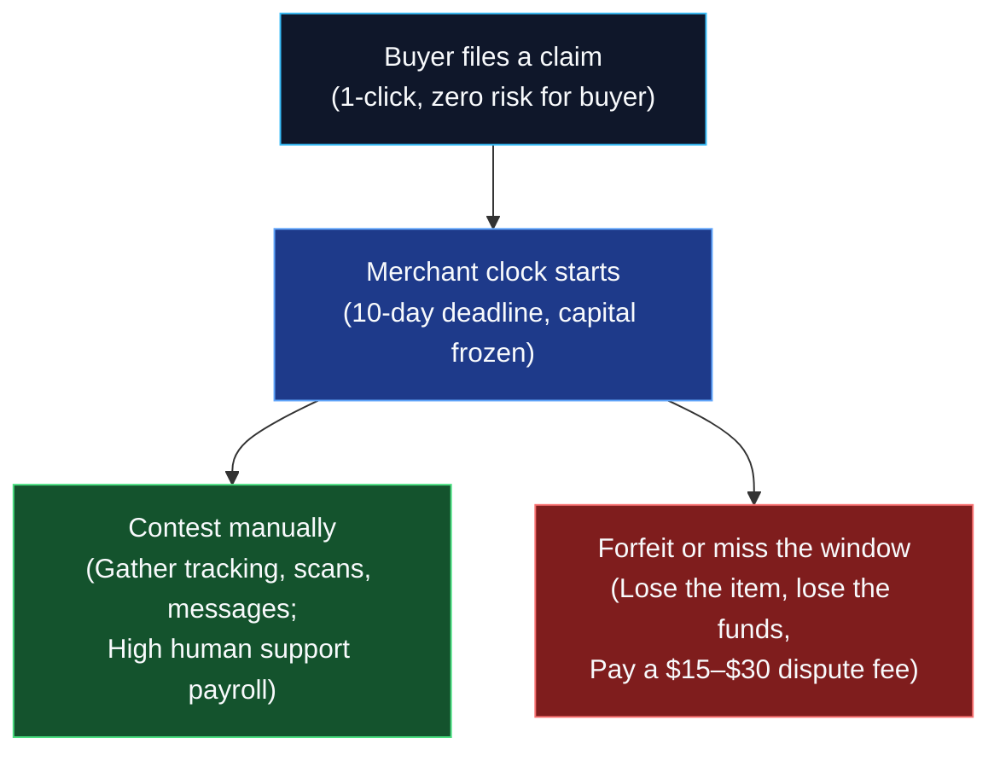
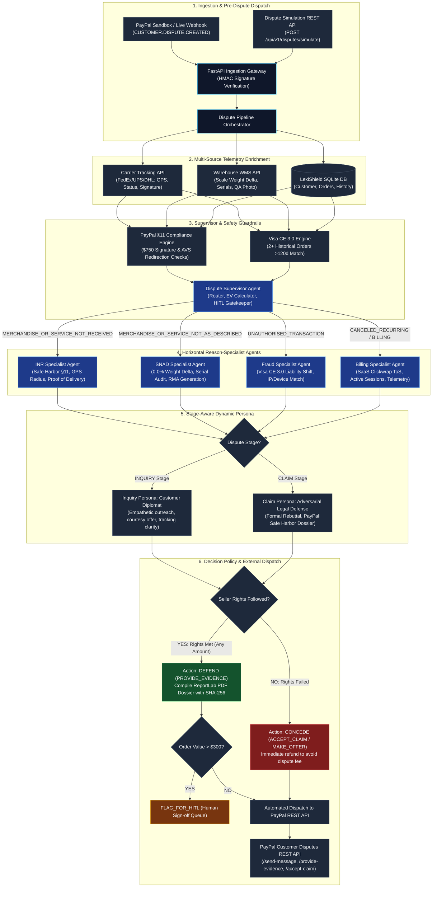
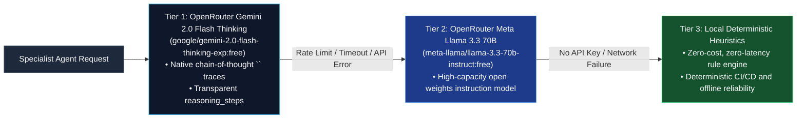
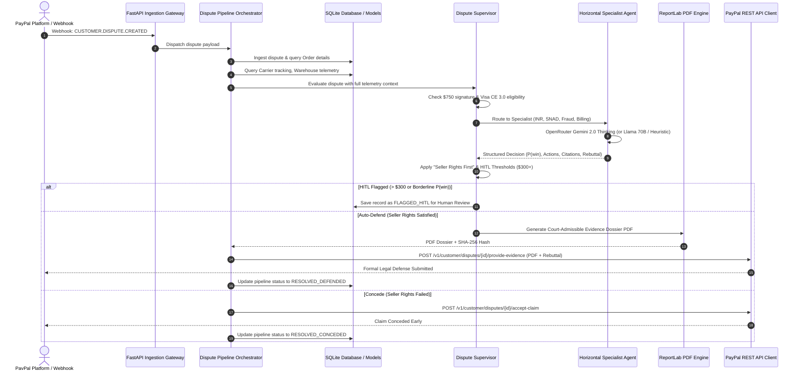

# Problem Statement and System Architecture: Automated PayPal Dispute Resolution

---

## 1. Problem Statement

In global digital commerce, merchants are trapped in an asymmetric dispute framework where the procedural and financial burden falls almost entirely on the seller. A buyer files a one-click, zero-risk claim through PayPal or their issuing bank. The merchant immediately faces a rigid **10-day evidentiary clock** (or as little as **20 hours** for pre-chargeback alerts like Verifi/Ethoca) and frozen merchant working capital, leaving two options:

1. **Contest manually**: Requires high human support payroll, deep familiarity with PayPal's complex Seller Protection Policies (§11), and manual assembly of fragmented records across carriers, ERPs, and warehouse databases.
2. **Forfeit or miss the window**: The merchant loses the physical goods, forfeits the transaction revenue, absorbs unrecoverable interchange/processing fees, and is charged a non-refundable **\$15–\$30 dispute fee** per case.

Either path imposes severe operational friction: manual contesting drains payroll, while default forfeiture bleeds operating margins and degrades the merchant's dispute-to-sales ratio.

---

## 2. Key Pain Points & Empirical Proof

### Key Pain Points
* **Evidentiary Overhead**: When a dispute is filed, merchants must locate tracking numbers, carrier delivery timestamps, GPS delivery coordinates, warehouse packaging line logs, barcode serials, and customer communications across disparate systems within rigid deadlines (10 days for PayPal claims; 20 hours for pre-dispute alerts).
* **Operational Fatigue and Default Forfeiture**: Small-to-medium businesses (SMBs) lack dedicated fraud operations teams. As a result, merchants forfeit defensible disputes simply because compiling evidence manually costs more in labor than the item's margin.
* **The Multiplier Penalty & Account Freezes**: Even when merchants win a dispute, they absorb investigation overhead. If a merchant's dispute ratio crosses card network and PayPal thresholds (typically **1.0% to 1.5%**), the merchant is categorized as "High Volume Dispute" and faces penalty fees and rolling account reserves or outright termination.

### Empirical Proof: The Scale of Merchant Burden

| Finding | Evidence & Source |
| :--- | :--- |
| **The \$5+ Multiplier** | According to the *LexisNexis Risk Solutions True Cost of Fraud Study*, retail and e-commerce companies face more than **\$5.00 in total costs for every \$1.00 lost to fraud and chargebacks**. This accounts for operational overhead, investigations, legal fees, inventory replacement, and interchange charges. |
| **Friendly Fraud Dominance** | Industry reports from *Chargebacks911* and *Mastercard* estimate that **40% to 75% of all filed disputes are "friendly fraud"**: first-party misuse where a buyer legitimate received goods or services but claimed non-receipt, authorization failure, or cosmetic defects. |
| **High Concession & Non-Contest Rates** | Studies indicate that only about **40% to 60% of merchants actively contest their disputes**. The remaining **40%+ are forfeited by default** due to procedural exhaustion, lack of automated tooling, and manual labor costs. |
| **Net Recovery Reality** | Even among merchants who contest cases manually, the net recovery rate hovers around **10%–21%**, largely caused by missed deadlines, second-cycle card disputes, and failure to cite exact technical safe-harbor requirements. |
| **Direct PayPal Penalties** | If a merchant's dispute ratio breaches PayPal's high-volume threshold (**1.5% or higher**, with more than 100 transactions in trailing 3 months), the mandatory dispute fee doubles from **\$15.00 to \$30.00 per claim**, billed regardless of outcome. |

---

## 3. Architecture Evolution: From Direct LLM Pipeline to Horizontal Agentic AI

### The Limitations of the Legacy Monolithic Direct LLM Pipeline
In early iterations, automated dispute systems used a single monolithic "Multimodal arbitration LLM" to handle all dispute types uniformly. This approach had fundamental structural flaws:
1. **Lack of Specialized Legal Domain Reasoning**: Evaluating courier safe-harbor rules (PayPal §11) requires entirely different evidentiary checks than evaluating SaaS clickwrap license agreements or physical packaging tare weights. A single generic prompt fails to apply specialized scrutiny.
2. **Arbitrary Micro-Concessions**: Monolithic systems often concede claims under \$15 automatically because naive Expected Value ($E[V]$) models treat them as economically insignificant—overlooking that the marginal cost of AI defense is \$0.00, winning waives the \$15 penalty fee, protects the merchant's dispute ratio, and stops micro-chargeback farming.
3. **Absence of Stage-Aware Personas**: An LLM acting as an adversarial courtroom litigator during an informal customer *Inquiry* alienates buyers, causing premature escalation. Conversely, a customer-service diplomat during a formal *Claim* fails to assert statutory safe harbor rights against bank reviewers.

### The New Architecture: Horizontal Specialist Agentic Hierarchy
To overcome these limitations, LexiShield implements a **Horizontal Agentic AI Architecture** built on **LangChain** and powered by **OpenRouter's Gemini 2.0 Flash Thinking** (with **Meta Llama 3.3 70B Instruct** and **deterministic heuristic fallbacks**).

The architecture separates routing, domain-specialist legal analysis, stage persona dispatching, and evidentiary compilation into distinct modular agents.

---

## 4. System Architecture (Horizontal Agentic AI Engine)

---

## 5. Core Decision Policy: "Seller Rights First" (Universal Defense)

A fundamental design tenet of LexiShield is the **Universal Defense Policy**:

> **Rule: If the merchant satisfies PayPal Seller Protection rights or card network rules, the AI engine DEFENDS the case for ANY transaction amount (\$1 to \$10,000+). The engine NEVER concedes a claim where valid proof exists.**

### Why Defend Any Amount With Proof?
1. **100% Capital Recovery**: Under PayPal Seller Protection (§11), when the seller satisfies requirements, PayPal covers 100% of the disputed amount.
2. **Fee Waiver**: Winning or successfully defending under Seller Protection waives the **\$15.00 to \$30.00 dispute fee**.
3. **Dispute Ratio Preservation**: Every concession increments the merchant’s chargeback ratio. Defending preserves the merchant's standing under the 1.0% threshold.
4. **Zero Marginal AI Cost**: Automated agentic drafting and PDF compilation costs \$0.00 marginal labor, eliminating the legacy economic rationale for default forfeiture of small amounts.
5. **Anti-Farming Deterrence**: Auto-conceding small transactions creates an attack vector where fraudsters farm micro-refunds from stores.

### Decision Matrix

| Evidentiary Standing | Dispute Amount | Stage | Recommended Action | Operational Execution |
| :--- | :--- | :--- | :--- | :--- |
| **Seller Rights Met** (Full Proof) | **Any Amount** (\$1 – \$300) | `CLAIM` | `PROVIDE_EVIDENCE` | Auto-compiles ReportLab PDF evidence dossier, submits via PayPal API. |
| **Seller Rights Met** (Full Proof) | **High Value** (> \$300) | `CLAIM` | `FLAG_FOR_HITL` | Compiles full evidence dossier, flags for mandatory human sign-off before API dispatch. |
| **Seller Rights Met** (Full Proof) | **Any Amount** | `INQUIRY` | `SEND_MESSAGE` | Shares courier tracking, GPS coordinates, and delivery confirmation courteously to resolve early. |
| **Seller Rights Failed** (No Proof / Defect) | **Any Amount** | `CLAIM` | `ACCEPT_CLAIM` | Concedes transaction early to mitigate formal appeal penalties and fee escalation. |
| **Seller Rights Failed** (No Proof / Defect) | **Any Amount** | `INQUIRY` | `MAKE_OFFER` | Proactively offers a 50% courtesy partial refund or replacement before formal escalation. |

---

## 6. Horizontal Specialist Agent Specifications

### 1. `DisputeSupervisor` (Router & Financial Gatekeeper)
* **Role**: Ingests incoming dispute payloads, validates tenant rules, evaluates compliance guardrails, and routes cases horizontally.
* **Financial Modeling**: Calculates win probability $P(\text{win})$ and Expected Value $E[V]$:
  $$E[V] = P(\text{win}) \times \text{OrderValue} - (1 - P(\text{win})) \times (\text{OrderValue} + \text{DisputeFee})$$
* **HITL Safety Gate**: Automatically enforces human review if:
  * Order value $> \$300.00$
  * Borderline win probability: $0.60 \le P(\text{win}) < 0.75$
  * High-risk tenant anomaly alerts are raised.

---

### 2. `INRAgent` (Item Not Received Specialist)
* **Governing Rule**: PayPal Seller Protection Policy §11 (Proof of Delivery Requirements).
* **Key Evidentiary Checks**:
  * Courier tracking status == `DELIVERED`.
  * Physical destination address matches transaction confirmed address (anti-AVS redirection).
  * Geolocation GPS coordinates match recipient delivery address within standard courier tolerance.
  * **\$750+ Signature Mandate**: If transaction value $\ge \$750.00$, strictly verifies verifiable recipient signature.
* **Stage Behaviors**:
  * *Inquiry*: Acts as a delivery concierge, providing tracking links, exact drop-off timestamps, GPS confirmation, and courier contact details.
  * *Claim*: Asserts §11 safe-harbor immunity, cites carrier timestamps and signature cards, and compiles a comprehensive shipping affidavit.

---

### 3. `SNADAgent` (Significantly Not As Described Specialist)
* **Governing Rule**: Physical Warehouse Telemetry, Barcode Serial Auditing, and Return Merchandise Authorization (RMA) Protocols.
* **Key Evidentiary Checks**:
  * **Scale Tare Weight Delta**: Verifies pack-station calibrated scale weight against expected product catalog weight. Discrepancy $\le 2.0\%$ (ideal 0.0%) proves all items and components were inside the sealed carton.
  * **Barcode Serial / IMEI Scan**: Confirms individual serialized hardware scans at the packing station matching order invoice.
  * **Tamper Seal & QA Station Photos**: Inspects pre-dispatch packaging photos proving pristine outbound condition.
  * **Mandatory RMA Enforcement**: Demands the buyer return the product with an authorized RMA tracking number before any refund consideration.
* **Stage Behaviors**:
  * *Inquiry*: Empathetically troubleshoots customer setup, offers replacement accessories, or issues a prepaid RMA return label.
  * *Claim*: Submits packing station timestamps, 0.0% weight delta certifications, and serialized inspection photos proving the item sent matched specifications.

---

### 4. `FraudAgent` (Unauthorized Transaction & Friendly Fraud Specialist)
* **Governing Rule**: Visa Compelling Evidence 3.0 (CE 3.0) and PayPal Unauthorized Transaction Safe Harbor.
* **Key Evidentiary Checks**:
  * **Visa CE 3.0 Network Liability Shift**: Identifies at least 2 historical, undisputed transactions from the same cardholder older than 120 days matching the current transaction on at least 2 core identifiers:
    * Matching IP address or device fingerprint
    * Matching confirmed shipping address
    * Matching user account login ID
  * **AVS & CVV Match**: Verifies full address verification system match (Y/Y) and CVV match at authorization.
* **Stage Behaviors**:
  * *Inquiry*: Politely confirms buyer account activity, displays purchase confirmation timestamps, and prompts the buyer to check with family or household members.
  * *Claim*: Formally submits CE 3.0 qualifying transaction logs, shifting legal chargeback liability back to the card issuer under Visa rules.

---

### 5. `BillingAgent` (Canceled Recurring & Subscription Specialist)
* **Governing Rule**: Clickwrap SaaS Contract Assent, Cancellation Policy Windows, and Telemetry Usage Logs.
* **Key Evidentiary Checks**:
  * **Clickwrap Assent**: Digital audit trail of terms acceptance at initial checkout.
  * **Active Telemetry Post-Cancellation**: Cloud server login timestamps, API key requests, or platform activity occurring after the alleged cancellation date.
  * **Grace Period Compliance**: Verifies whether cancellation was received within refund policy grace windows.
* **Stage Behaviors**:
  * *Inquiry*: Clarifies subscription status, offers billing pauses or plan adjustments, and presents cancellation policy details.
  * *Claim*: Submits active user session telemetry, IP access logs, and signed terms of service proving active utilization and valid billing consent.

---

## 7. Multi-Model LLM Orchestration & Zero-Downtime Fallback

LexiShield utilizes a three-tier resilient orchestration stack:

1. **Tier 1 (Primary)**: `google/gemini-2.0-flash-thinking-exp:free` via OpenRouter.
   * Leverages deep mathematical and legal reasoning capabilities.
   * Extracts native `<thought>` blocks directly into structured `reasoning_steps` for complete audit transparency in dispute responses and compiled PDF dossiers.
2. **Tier 2 (Fallback)**: `meta-llama/llama-3.3-70b-instruct:free` via OpenRouter.
   * Provides high-parameter instruction-following capabilities when rate limits or maintenance windows occur on Tier 1.
3. **Tier 3 (Offline / Deterministic Heuristics)**:
   * Embedded rule-based probabilistic evaluation engines located directly in the codebase.
   * Guarantees 100% operational uptime, test reproducibility, and deterministic local development without requiring external cloud credentials.

---

## 8. Evidentiary Dossier Generation: Cryptographic PDF Standard

When an agent triggers the `PROVIDE_EVIDENCE` defense path, it compiles a multi-page evidentiary dossier using **ReportLab**:

* **Header & Cover Page**: Formal dispute metadata, case ID, PayPal reference, transaction amount, and merchant details.
* **Statutory Defense Statement**: Custom legal rebuttal narrative drafted by the specialist agent citing specific policy clauses (§11, CE 3.0, RMA terms).
* **Telemetry Evidence Exhibits**:
  * Exhibit A: Courier tracking summary, delivery timestamp, GPS coordinates, and recipient signature card.
  * Exhibit B: Warehouse fulfillment log, scale tare weight verification certificate (0.0% variance), and scanned serial barcodes.
  * Exhibit C: Prior undisputed transaction history (Visa CE 3.0 compliance) or active server session telemetry.
* **Cryptographic Integrity (SHA-256)**: Generates a cryptographic SHA-256 hash of the compiled dossier, logged in the database audit trail to prove non-tampering.

---

## 9. Operational Lifecycle Walkthrough

---

## 10. Summary of Architectural Guarantees

1. **Zero Unjustified Forfeitures**: Any dispute backed by verified seller rights is defended regardless of ticket size.
2. **Specialized Legal Precision**: Every dispute reason is handled by a tailored domain agent with reason-specific statutory knowledge.
3. **Stage-Aware Interactions**: Empathetic customer concierge during informal inquiries; rigorous defense counsel during formal claims.
4. **Transparent Thought Traces**: Complete legal reasoning chain-of-thought visible in API responses and compiled evidence dossiers.
5. **Zero-Downtime Resilience**: Seamless triple-tier fallback from Gemini 2.0 Thinking to Llama 3.3 70B to local deterministic heuristics.

