# LexiShield: Enterprise PayPal Dispute Defense & Deflection Engine

[](https://www.python.org/downloads/)
[](https://fastapi.tiangolo.com/)
[](https://docs.pydantic.dev/)
[](LICENSE)
[](https://www.ag-grid.com/)
[](https://www.postman.com/)
[](https://render.com/)
[](https://vercel.com/)
[](https://github.com/Sarvesha302005/LexiShield/actions/workflows/ci.yml)
[](https://github.com/Sarvesha302005/LexiShield/actions/workflows/security-scan.yml)
[](https://github.com/Sarvesha302005/LexiShield/actions/workflows/docker.yml)
[-brightgreen.svg)]()

**LexiShield** is an autonomous chargeback defense and dispute deflection engine built on Python 3.12+, FastAPI, Pydantic v2, and AsyncIO. It transitions dispute resolution from a passive pipeline into an active, multi-layered financial defense shield.

---

## 1. Enterprise Defense Architecture

LexiShield operates on an event-driven, zero-trust financial architecture engineered to detect, deflect, and defend PayPal disputes autonomously.

```mermaid
flowchart LR
    %% Modern Compact Architecture
    subgraph S1 ["1. Ingress & Deflection"]
        WH["PayPal Webhooks<br/><code>CUSTOMER.DISPUTE.*</code>"]
        ALT["Card Issuer Alerts<br/><code>Ethoca & Verifi RDR</code>"]
        SEC["Cryptographic Shield<br/>X.509 CA & RSA Sig"]
    end

    subgraph S2 ["2. Telemetry Mesh"]
        POD["Carrier Logistics<br/>GPS & Proof of Delivery"]
        SCALE["Warehouse Sensors<br/>Scale Weight & Barcodes"]
        CRM["Order DB & LTV<br/>Customer Ledger & IPs"]
    end

    subgraph S3 ["3. Horizontal Agentic AI & Compliance"]
        COMPL["Policy Guardrails<br/>$750+ Sig & AVS Match"]
        CE3["Visa CE 3.0 Engine<br/>2-Factor IP/Device Match"]
        SUP["DisputeSupervisor<br/>Seller Rights First + EV"]
        SPEC["Domain Specialists<br/>INR / SNAD / Fraud / Billing"]
        LLM["3-Tier OpenRouter<br/>Gemini 2.0 Thinking → Llama 70B → Heuristics"]
    end

    subgraph S4 ["4. Adjudication & Ledger"]
        PDF["ReportLab + SHA-256<br/>Cryptographic PDF Dossier"]
        BOT["Stage-Aware Personas<br/>Customer Diplomat / Legal Defense"]
        API["PayPal REST APIs<br/><code>provide-evidence / refund</code>"]
        ERP["ERP Sync & RMA<br/>NetSuite / QuickBooks"]
    end

    ALT -->|Pre-Dispute Zero-Fee Refund| API
    WH --> SEC --> S2
    S2 --> S3
    S3 -->|Inquiry Stage| BOT --> API
    S3 -->|Claim Defense| PDF --> API
    S3 -->|Unwinnable Policy Void| API
    API --> ERP
```



### Architecture Pipeline Overview

| Stage | Primary Responsibility | Key Technologies |
| :--- | :--- | :--- |
| **1. Ingress & Deflection** | Ingests PayPal dispute webhooks and pre-chargeback alerts (Ethoca / Verifi) 20–72h prior to posting. Executes automated zero-fee refunds to eliminate $15–$30 dispute fees and preserve dispute ratios. | FastAPI, Cryptography (RSA/X.509), Pydantic v2 |
| **2. Telemetry Mesh** | Executes parallel, asynchronous queries across carrier APIs (FedEx, UPS, USPS), warehouse scale sensors (weight variance & barcode scans), and customer history. | AsyncIO (`asyncio.gather`), Carrier Connectors |
| **3. Horizontal Agentic AI & Compliance** | Routes disputes via `DisputeSupervisor` to domain specialists (`INRAgent`, `SNADAgent`, `FraudAgent`, `BillingAgent`), enforces PayPal §11 & Visa CE 3.0, applies **Seller Rights First** universal defense, and runs 3-tier LangChain/OpenRouter orchestration (Gemini 2.0 Flash Thinking -> Llama 3.3 70B -> Heuristics). | LangChain, OpenRouter (Gemini 2.0 Thinking / Llama 3.3 70B), Visa CE 3.0 |
| **4. Adjudication & Ledger** | Applies Stage-Aware Dynamic Personas (`Customer Diplomat` vs `Adversarial Legal Defense`), compiles cryptographic ReportLab PDF dossiers with SHA-256 integrity hashes logged in the audit trail, dispatches to PayPal REST endpoints, and syncs double-entry ERP ledgers. | ReportLab PDF + SHA-256, PayPal REST API, ERP Webhooks |

---

## 2. Core Enterprise Defense Pillars

### 1. PayPal Seller Protection Compliance & Policy Guardrails
* **The $750+ Signature Mandate**: Tangible orders of $\$750.00\text{ USD}$ or higher strictly require courier signature confirmation to qualify for Item Not Received (INR) protection. If signature telemetry is missing, the engine automatically caps $P(win)$ at $0.05$ and concedes to avoid paying non-refundable dispute fees on unwinnable cases.
* **AVS Exact Address Matching & Redirection**: Compares delivered coordinates with the confirmed PayPal shipping address. If tracking events indicate the buyer rerouted or redirected the parcel post-dispatch, PayPal revokes Seller Protection; LexiShield highlights this violation in the rebuttal dossier.
* **Category Exclusion Filtering**: Applies distinct evidence templates tailored to **INR** (logistics telemetry & GPS), **SNAD** (pre-shipment QA inspection & hardware serial matching), or **Digital Goods** (access timestamps, IP logs, and license activations).

### 2. Visa Compelling Evidence 3.0 (CE 3.0) Engine
* **Pre-Dispute Historical Ledger Query**: For Reason Code 10.4 (Card-Not-Present Fraud), queries the merchant ledger for **at least two undisputed prior transactions** from the same cardholder between 120 and 365 days prior.
* **Two-Factor Matching Verification**: Validates that prior transactions share matching core elements: technical identifier (**IP address** or **device fingerprint**) plus identity factor (**customer ID** or **shipping address**).
* **Automated CE 3.0 Rebuttal Schedule**: Injects an immutable historical ledger schedule directly into the ReportLab PDF dossier, shifting chargeback liability away from the merchant under card network rules.

### 3. Pre-Chargeback Deflection via Alert Networks (Ethoca & Verifi RDR)
* **Early Card Issuer Notifications**: Listens to alert webhooks delivered 20–72 hours *before* a chargeback formally posts.
* **Zero-Fee Automated Refund**: Matches inbound alerts to active orders and issues an immediate transaction refund via PayPal. This satisfies the card issuer alert, preventing `CUSTOMER.DISPUTE.CREATED` from ever firing, avoiding the $\$15–\$30$ dispute fee and maintaining a $0\%$ chargeback ratio.

### 4. Interactive Conversational Settlement Bot (Inquiry Stage)
* **Autonomous Buyer Negotiation**: Multi-turn conversational state machine operating before PayPal steps in to arbitrate:
  - *Turn 1 (Troubleshooting)*: Sends courier tracking links, verified GPS timestamps, and delivery verification steps via the **Customer Diplomat** persona.
  - *Turn 2 (Courtesy Settlement)*: Offers a $50\%$ courtesy partial refund or free replacement reshipment when Seller Rights fail or troubleshooting requires escalation.
  - *Turn 3 (Arbitration Handover)*: Prepares full evidentiary defense if negotiations break down.

### 5. Multi-Tenant Enterprise SaaS Infrastructure
* **Row-Level Security (RLS) Isolation**: Partitions disputes, ledgers, and settings by `merchant_id`.
* **Bring-Your-Own-Credentials (BYOK)**: Supports distinct encrypted PayPal credentials, webhook IDs, and risk thresholds per tenant.
* **Custom Rules Engine**: Lets each merchant configure custom HITL review cutoffs (e.g. $\$150$ vs $\$300$), minimum defense probabilities ($P(win) \ge 0.80$), and automated policy concessions.

### 6. ERP & Accounting Lifecycle Webhooks and RMA
* **Double-Entry Ledger Provisioning**: Dispatches accounting events compatible with NetSuite, QuickBooks, and Xero:
  - *Intake*: Records pending escrow liability (`Debit: 1050-Frozen-Escrow`, `Credit: 1010-Operating-Cash`).
  - *Defense Win*: Restores operating cash (`Debit: 1010-Operating-Cash`, `Credit: 1050-Frozen-Escrow`).
  - *Concession/Loss*: Writes off COGS and fees (`Debit: 6100-Dispute-Fee-Expense`, `Debit: 5010-COGS-Loss`).
* **Automated Return Labels (RMA)**: Generates prepaid carrier return labels and tracks inbound warehouse delivery scans before releasing refunds.

---

## 3. Directory Structure

```
├── .env.example                         # Environment configuration template
├── .gitignore                           # Git ignore rules for python & bytecode
├── pyproject.toml                       # Build config, dependencies & test configuration
├── Dockerfile                           # Multi-stage production container
├── docker-compose.yml                   # Service orchestration with health checks & persistent volumes
├── README.md                            # Complete engineering documentation
├── .github/
│   └── workflows/
│       ├── ci.yml                       # Python 3.12/3.13 matrix test & ruff linting
│       └── docker.yml                   # Docker buildx & container smoke testing
├── src/
│   ├── main.py                          # FastAPI app entrypoint, correlation IDs & middleware
│   ├── core/
│   │   ├── config.py                    # Pydantic v2 BaseSettings
│   │   ├── security.py                  # X.509 cert validation, SSRF shield, RSA signature verification
│   │   ├── tenant.py                    # Multi-tenant isolation & BYOK credential manager
│   │   └── exceptions.py                # Domain-specific custom exceptions
│   ├── models/
│   │   ├── schemas.py                   # Pydantic models for webhooks, telemetry & dispute records
│   │   ├── arbitration.py               # AI output schemas (P(win), EV, strategy, citations)
│   │   └── tenant.py                    # Multi-tenant schemas & custom rules
│   ├── agents/
│   │   ├── base.py                      # Stage-aware personas & BaseSpecialistAgent
│   │   ├── supervisor.py                # DisputeSupervisor router, EV & Seller Rights First policy
│   │   ├── inr_agent.py                 # Item Not Received (§11 safe harbor, GPS, $750 signature)
│   │   ├── snad_agent.py                # Significantly Not As Described (0.0% weight delta, RMA)
│   │   ├── fraud_agent.py               # Unauthorized & Friendly Fraud (Visa CE 3.0, AVS/CVV)
│   │   └── billing_agent.py             # Canceled Recurring / SaaS Clickwrap & session telemetry
│   ├── services/
│   │   ├── carrier.py                   # Logistics telemetry aggregator (EasyPost/FedEx mock with GPS)
│   │   ├── warehouse.py                 # Outbound packing telemetry (scale weights, barcode serials, photos)
│   │   ├── billing.py                   # SaaS clickwrap ToS assent & post-cancellation server telemetry
│   │   ├── order.py                     # Order database service & dispute fee tiering ($15 vs $30)
│   │   ├── compliance.py                # $750+ signature mandate, AVS check, redirection detector
│   │   ├── visa_ce3.py                  # Visa Compelling Evidence 3.0 pre-dispute matching engine
│   │   ├── alerts.py                    # Pre-chargeback deflection service (Ethoca & Verifi RDR)
│   │   ├── conversation_bot.py          # Multi-turn conversational settlement bot (Inquiry stage)
│   │   ├── accounting.py                # ERP double-entry ledger integration (NetSuite/QuickBooks)
│   │   ├── rma.py                       # Automated return label & inbound inspection manager
│   │   ├── llm_orchestrator.py          # 3-tier LangChain/OpenRouter engine (Gemini 2.0 -> Llama 70B -> Heuristics)
│   │   ├── llm_arbitrator.py            # Backward-compatible facade over DisputeSupervisor
│   │   ├── pdf_generator.py             # ReportLab evidentiary rebuttal PDF + SHA-256 integrity hash
│   │   └── paypal_client.py             # Resilient async HTTP client for PayPal Disputes REST API
│   ├── workflows/
│   │   └── dispute_pipeline.py          # Orchestrator chaining Ingestion -> Telemetry -> Policy -> Dispatch
│   └── api/
│       └── v1/
│           ├── __init__.py              # V1 router assembly
│           ├── webhooks.py              # Inbound PayPal dispute webhook intake
│           ├── disputes.py              # Dispute monitoring, PDF downloads, and HITL overrides
│           ├── alerts.py                # Pre-dispute card alert listener (Ethoca/Verifi)
│           ├── tenants.py               # Multi-tenant onboarding and custom rule management
│           └── rma.py                   # Automated RMA return label generation & verification
└── tests/
    ├── conftest.py                      # Cryptographic fixtures & sample payloads
    ├── test_compliance_guardrails.py    # Tests for $750 mandate, AVS checks, package redirection
    ├── test_visa_ce3.py                 # Tests for Visa CE 3.0 lookback & two-factor matching
    ├── test_advanced_features.py        # Tests for alert deflection, chat bot, ERP accounting, and RMA
    ├── test_arbitration_logic.py        # Tests for decision branching, P(win), and EV logic
    ├── test_horizontal_agents.py        # Tests for DisputeSupervisor, specialist agents, and Seller Rights First
    ├── test_llm_orchestrator.py         # Tests for 3-tier OpenRouter fallback & <thought> trace extraction
    ├── test_pdf_integrity.py            # Tests for SHA-256 PDF integrity, Exhibit C SaaS & HITL upfront dossiers
    ├── test_webhook_security.py         # Tests for signature verification, SSRF & tampering
    └── test_end_to_end_pipeline.py      # End-to-end integration tests for all decision paths
```

---

## 4. Quickstart & Local Setup

### Running with Docker Compose

```bash
# 1. Copy environment configuration
cp .env.example .env

# 2. Build and start container in detached mode
docker-compose up -d --build

# 3. View live logs
docker-compose logs -f dispute-engine
```

Open Swagger UI documentation at: `http://localhost:8000/docs`

---

### Local Python Environment

```bash
# 1. Install dependencies
pip install ".[dev]"

# 2. Start development server
uvicorn src.main:app --host 0.0.0.0 --port 8000 --reload
```

---

## 5. Running the Test Suite

Execute the full suite of **56 tests** with coverage metrics:

```bash
python -m pytest -v --cov=src --cov-report=term-missing
```

```text
============================= test session starts =============================
collected 56 items

tests/test_advanced_features.py .....                                    [  8%]
tests/test_arbitration_logic.py ........                                 [ 23%]
tests/test_compliance_guardrails.py ...                                  [ 28%]
tests/test_end_to_end_pipeline.py ............                           [ 50%]
tests/test_horizontal_agents.py .......                                  [ 62%]
tests/test_llm_orchestrator.py .....                                     [ 71%]
tests/test_pdf_integrity.py .....                                        [ 80%]
tests/test_visa_ce3.py ...                                               [ 85%]
tests/test_webhook_security.py ........                                  [100%]

=============================== tests coverage ================================
Coverage: 86% across 2,525 statements
============================= 56 passed in 2.47s ==============================
```

---

## 6. Key API Operations

### 1. Ingest Pre-Chargeback Alert (Ethoca / Verifi)
```bash
curl -X POST http://localhost:8000/api/v1/alerts/webhook \
  -H "Content-Type: application/json" \
  -d '{
    "alert_id": "ALT-ETH-8821",
    "network": "ETHOCA",
    "arn": "ARN-9988221100",
    "transaction_id": "TXN-7701",
    "amount": 199.00,
    "currency": "USD",
    "card_last4": "4242"
  }'
```

### 2. Onboard Tenant with BYOK Credentials & Custom Rules
```bash
curl -X POST http://localhost:8000/api/v1/tenants \
  -H "Content-Type: application/json" \
  -d '{
    "merchant_id": "merchant-acme",
    "name": "ACME E-Commerce",
    "paypal_client_id": "client_acme_123",
    "paypal_client_secret": "secret_acme_456",
    "paypal_webhook_id": "wh_acme_789",
    "custom_rules": {
      "hitl_order_value_threshold": 150.00,
      "defend_p_win_threshold": 0.75,
      "visa_ce3_enabled": true,
      "alert_auto_refund_enabled": true
    }
  }'
```

### 3. Generate Prepaid RMA Return Label
```bash
curl -X POST http://localhost:8000/api/v1/rma/generate \
  -H "Content-Type: application/json" \
  -d '{
    "order_id": "ORD-7701",
    "dispute_id": "PP-D-7701",
    "customer_name": "Taylor Ray"
  }'
```

---

## 7. PayPal AI Hackathon Sponsor Integrations

To ensure production polish, developer convenience, and institutional-grade reliability, LexiShield natively incorporates three official sponsor technologies:

### 1. AG Grid — Enterprise Dispute Workstation & Radar
* **Role in LexiShield:** Powering the primary **Live Dispute Radar** workstation at `http://localhost:8000/`.
* **Key Capabilities:**
  - Fast sorting and multi-column filtering across disputed amounts, win probabilities $P(win)$, and Expected Values $E[V]$.
  - Custom cell renderers for dynamic status badges (`SELLER PROTECTED`, `VISA CE 3.0`, `HITL REVIEW`), stage pills (`INQUIRY` vs. `CLAIM`), and inline action triggers (`Triage HITL`, `PDF Dossier`, `Inspect`).
  - Seamless toggle between dense AG Grid workstation view and executive card view.
  - Native client-side CSV export (`LexiShield_PayPal_Disputes.csv`).

### 2. Postman — Verified Evaluation & Test Suite
* **Role in LexiShield:** Providing judges and developers with zero-friction, one-click API testing without manual curl setup.
* **Included Artifacts:**
  - Collection: [`postman/LexiShield_PayPal_AI_Defense.postman_collection.json`](postman/LexiShield_PayPal_AI_Defense.postman_collection.json)
  - Environment: [`postman/LexiShield_PayPal_Sandbox.postman_environment.json`](postman/LexiShield_PayPal_Sandbox.postman_environment.json)
* **Features:**
  - Automated test assertions (`pm.test`) verifying 200 OK statuses, JSON schemas, and response headers (`X-Correlation-Id`).
  - Endpoints covering PayPal webhook intake, dispute lifecycle queries, HITL review overrides, Ethoca/Verifi alert deflection, and multi-tenant BYOK configuration.

### 3. Render — Zero-Config Cloud Infrastructure (`render.yaml`)
* **Role in LexiShield:** Infrastructure-as-Code blueprint for instant deployment to Render Cloud.
* **Blueprint:** [`render.yaml`](render.yaml)
* **Configuration:**
  - Docker container web service runtime with Python 3.12+ and FastAPI.
  - Persistent disk volume mount (`/app/artifacts`) for generated PDF rebuttal dossiers.
  - Health check path configured to `/health` with automated branch deployment on push to `main`.

---

## 8. Cloud Deployment Topology (Vercel + Render)

LexiShield uses a decoupled, highly resilient dual-cloud deployment topology engineered for speed, high availability, and zero-cost operation on free tiers:

```
                      ┌───────────────────────────────────────────────┐
                      │              Global Web Clients               │
                      └───────┬───────────────────────────────┬───────┘
                              │                               │
                Primary UI    │                               │ Fallback UI
              (Edge Route)    ▼                               ▼ (Direct Host)
        ┌──────────────────────────────┐            ┌───────────────────────────────────┐
        │       VERCEL (FRONTEND)      │            │       RENDER (FALLBACK UI)        │
        │ • React 18 / Vite / Tailwind │            │ • FastAPI Static Asset Mount      │
        │ • Global Edge CDN (Hobby)    │            │ • Serves src/static at root (/)   │
        │ • Root: frontend/            │            │ • High-availability UI backup     │
        └──────────────┬───────────────┘            └─────────────────┬─────────────────┘
                       │                                              │
                       │ API Calls (VITE_API_BASE_URL)                │ Direct Same-Origin
                       ▼                                              ▼
        ┌───────────────────────────────────────────────────────────────────────────────┐
        │                         RENDER (FASTAPI CORE BACKEND)                         │
        │ • Multi-stage Docker Runtime (Python 3.12+ & Uvicorn)                         │
        │ • 3-Tier MultiModelLLMOrchestrator (Gemini 2.0 / Nemotron / Llama 70B)       │
        │ • ReportLab Evidentiary PDF Rebuttal Compiler with SHA-256 Digest             │
        │ • PayPal REST Disputes & Cryptographic Webhook Intake (/api/v1/webhooks)      │
        │ • SQLite / PostgreSQL Async Database Engine with Automatic Seed Data          │
        │ • Webhook Deploy Hook for Automated CI/CD on git push                         │
        └───────────────────────────────────────────────────────────────────────────────┘
```

### Infrastructure Component Matrix

| Layer | Host Platform | Source Path / Technology | Responsibilities & Failover |
| :--- | :--- | :--- | :--- |
| **Frontend** | **Vercel** | `frontend/` (Vite, React 18, Tailwind, Lucide) | **Primary User Interface:** Hosted across Vercel's global Edge CDN for instantaneous page loads. Connects to the backend via `VITE_API_BASE_URL` with client-side failover routing. |
| **Frontend Fallback** | **Render** | `src/static/` (FastAPI `StaticFiles` Mount) | **Failover / Standalone Interface:** The production Docker container pre-bundles compiled static assets. If Vercel is unreachable or in unified-service mode, navigating directly to the Render service URL serves the full React/AG Grid dashboard. |
| **FastAPI Backend** | **Render** | `src/` (`Dockerfile`, Uvicorn, Python 3.12) | **Core Defense Engine:** Ingests PayPal webhooks, executes X.509 signature checks, runs 3-tier LLM arbitration specialists, compiles PDF dossiers, and powers `/api/v1` REST routes. Configured with automated redeploy hooks on push. |


