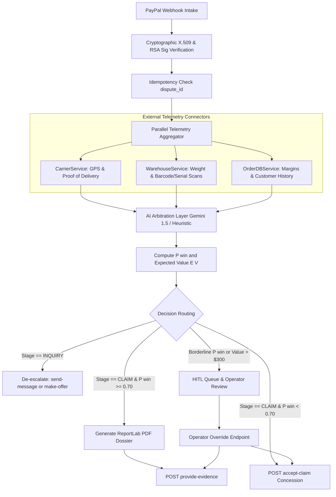

# Automated PayPal Dispute Resolution Engine

[](https://www.python.org/downloads/)
[](https://fastapi.tiangolo.com/)
[](https://docs.pydantic.dev/)
[](https://github.com/Sarvesha302005/LexiShield/actions/workflows/ci.yml)
[](https://github.com/Sarvesha302005/LexiShield/actions/workflows/docker.yml)
[-brightgreen.svg)]()

Enterprise-grade, automated dispute resolution, AI arbitration, and evidence rebuttal system built on Python 3.12+, FastAPI, Pydantic v2, and AsyncIO.

---

## 1. Architectural Architecture & Workflow



---

## 2. Decision Logic & Financial Risk Engine

The engine computes **Win Probability $P(win)$** and **Expected Value $E[V]$** to guide financial decisions:

$$E[V] = P(win) \times V_{order} - (1 - P(win)) \times (V_{order} + F_{dispute})$$

Where:
- $V_{order}$ = Disputed transaction gross amount.
- $F_{dispute}$ = Applied dispute fee:
  - **Standard Fee**: $\$15.00$
  - **High-Volume Fee**: $\$30.00$ (triggered when merchant monthly disputes count $\ge 100$).
- $P(win)$ = Win probability derived from carrier delivery confirmation, courier GPS telemetry, signed recipient, barcode/serial match, and scale weight variance.

### Branching Rules
1. **Stage `INQUIRY`**:
   - De-escalate proactively: dispatches `send-message` (if $P(win) \ge 0.50$) or `make-offer` with partial settlement (if $P(win) < 0.50$).
2. **Stage `CLAIM`**:
   - **$P(win) \ge 0.70$ (Defense)**: Compiles an evidentiary PDF rebuttal dossier using ReportLab and submits via `POST /v1/customer/disputes/{id}/provide-evidence`.
   - **$P(win) < 0.70$ (Concession)**: Submits immediate claim concession via `POST /v1/customer/disputes/{id}/accept-claim` to avoid escalated arbitration fees and penalties.
3. **Edge Cases (Human-in-the-Loop)**:
   - Order Value $> \$300.00$ OR $0.60 \le P(win) < 0.75$: Flags dispute for manual review (`FLAGGED_HITL`), preventing irreversible automated actions until approved via the HITL API.

---

## 3. Directory Structure

```
paypal_dispute_engine/
├── .env.example                         # Environment variable definitions
├── pyproject.toml                       # Build config, dependencies & tool settings
├── Dockerfile                           # Multi-stage production container
├── docker-compose.yml                   # Service orchestration with healthcheck
├── README.md                            # Complete engineering documentation
├── src/
│   ├── __init__.py
│   ├── main.py                          # FastAPI entrypoint, lifespan, CORS & middleware
│   ├── core/
│   │   ├── config.py                    # Pydantic BaseSettings
│   │   ├── security.py                  # X.509 cert validation, SSRF checks, RSA signatures
│   │   └── exceptions.py                # Domain exceptions & HTTP mappings
│   ├── models/
│   │   ├── schemas.py                   # Pydantic v2 schemas for webhooks, telemetry & records
│   │   └── arbitration.py               # AI output schemas (P(win), EV, strategy, citations)
│   ├── services/
│   │   ├── carrier.py                   # Carrier tracking aggregator (EasyPost/FedEx mock)
│   │   ├── warehouse.py                 # Outbound packing telemetry & image retriever
│   │   ├── order.py                     # Order database service & dispute fee tiering
│   │   ├── llm_arbitrator.py            # Gemini 1.5 multimodal reasoning & heuristic arbitrator
│   │   ├── pdf_generator.py             # ReportLab evidentiary PDF rebuttal builder
│   │   └── paypal_client.py             # Resilient async PayPal REST API client
│   ├── workflows/
│   │   └── dispute_pipeline.py          # Orchestrator chaining Intake -> Gather -> Arbitrate -> Dispatch
│   └── api/
│       ├── __init__.py
│       └── v1/
│           ├── __init__.py              # V1 router assembly
│           ├── webhooks.py              # POST /api/v1/paypal/webhook
│           └── disputes.py              # GET/POST /api/v1/disputes (queue, PDF, stats, override)
└── tests/
    ├── conftest.py                      # RSA keypair fixtures, cert mocks & sample dispute JSONs
    ├── test_webhook_security.py         # Tests for signature verification, SSRF & tampering
    ├── test_arbitration_logic.py        # Tests for decision branching, P(win), and EV logic
    └── test_end_to_end_pipeline.py      # End-to-end integration tests for all 3 paths & HITL
```

---

## 4. Local Setup & Quickstart

### Option A: Running with Docker Compose (Recommended)

```bash
# 1. Copy environment configuration
cp .env.example .env

# 2. Build and start container in detached mode
docker-compose up -d --build

# 3. Inspect service logs
docker-compose logs -f dispute-engine
```

Access Swagger UI documentation at: `http://localhost:8000/docs`

---

### Option B: Local Python Environment

```bash
# 1. Install dependencies
pip install .

# 2. Start development server
uvicorn src.main:app --host 0.0.0.0 --port 8000 --reload
```

---

## 5. Running the Test Suite

Run unit and integration tests with coverage reporting:

```bash
python -m pytest -v --cov=src --cov-report=term-missing
```

Output:
```text
============================= 28 passed in 3.38s ==============================
Coverage: 87% across all core engines and endpoints.
```

---

## 6. API Reference & Sample cURL Requests

### 1. Ingest PayPal Webhook
```bash
curl -X POST http://localhost:8000/api/v1/paypal/webhook \
  -H "Content-Type: application/json" \
  -H "PAYPAL-AUTH-ALGO: SHA256withRSA" \
  -H "PAYPAL-TRANSMISSION-ID: TRANS-98214" \
  -H "PAYPAL-CERT-URL: https://api.paypal.com/cert.pem" \
  -H "PAYPAL-TRANSMISSION-SIG: <base64_sig>" \
  -H "PAYPAL-TRANSMISSION-TIME: 2026-10-18T12:00:00Z" \
  -d '{
    "id": "WH-EVT-001",
    "event_version": "1.0",
    "create_time": "2026-10-18T12:00:00Z",
    "resource_type": "dispute",
    "event_type": "CUSTOMER.DISPUTE.CREATED",
    "resource": {
      "dispute_id": "PP-D-7701",
      "create_time": "2026-10-18T11:55:00Z",
      "dispute_stage": "CLAIM",
      "dispute_reason": "MERCHANDISE_OR_SERVICE_NOT_RECEIVED",
      "status": "WAITING_FOR_SELLER_RESPONSE",
      "dispute_amount": { "currency_code": "USD", "value": "199.00" },
      "disputed_transactions": [{
        "seller_transaction_id": "TXN-7701",
        "invoice_number": "ORD-7701",
        "gross_amount": { "currency_code": "USD", "value": "199.00" }
      }]
    }
  }'
```

### 2. Check Dispute Analytics & Avoided Fees
```bash
curl -X GET http://localhost:8000/api/v1/disputes/stats/summary
```
**Response:**
```json
{
  "total_disputes": 4,
  "defended_count": 2,
  "conceded_count": 1,
  "de_escalated_count": 1,
  "hitl_queue_count": 0,
  "total_disputed_amount": 1098.00,
  "total_expected_value": 724.50,
  "estimated_dispute_fees_avoided": 45.00,
  "average_win_probability": 0.765
}
```

### 3. Inspect HITL Review Queue
```bash
curl -X GET http://localhost:8000/api/v1/disputes/hitl/queue
```

### 4. Submit Human Override for a Flagged Dispute
```bash
curl -X POST http://localhost:8000/api/v1/disputes/PP-D-HITL-5501/hitl/override \
  -H "Content-Type: application/json" \
  -d '{
    "reviewer_id": "OPERATOR_ALICE",
    "action": "DEFEND",
    "override_reason": "Confirmed signature and matched packing scale telemetry with GPS proof."
  }'
```

### 5. Download Evidentiary Rebuttal PDF Dossier
```bash
curl -X GET http://localhost:8000/api/v1/disputes/PP-D-7701/pdf --output dispute_7701_evidence.pdf
```
