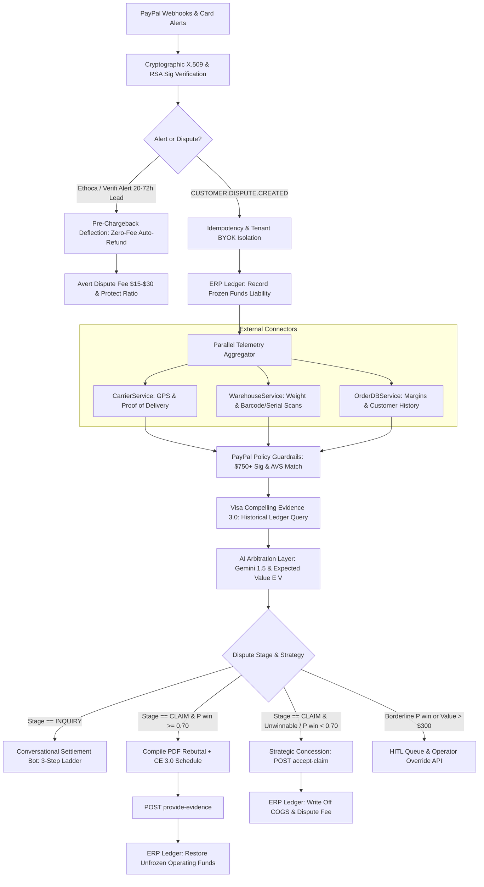

# LexiShield: Enterprise PayPal Dispute Defense & Deflection Engine

[](https://www.python.org/downloads/)
[](https://fastapi.tiangolo.com/)
[](https://docs.pydantic.dev/)
[](https://github.com/Sarvesha302005/LexiShield/actions/workflows/ci.yml)
[](https://github.com/Sarvesha302005/LexiShield/actions/workflows/docker.yml)
[-brightgreen.svg)]()

**LexiShield** is an autonomous chargeback defense and dispute deflection engine built on Python 3.12+, FastAPI, Pydantic v2, and AsyncIO. It transitions dispute resolution from a passive pipeline into an active, multi-layered financial defense shield.

---

## 1. Enterprise Defense Architecture



---

## 2. Core Enterprise Defense Pillars

### 1. PayPal Seller Protection Compliance & Policy Guardrails
* **The $750+ Signature Mandate**: Tangible orders of $\$750.00\text{ USD}$ or higher strictly require courier signature confirmation to qualify for Item Not Received (INR) protection. If signature telemetry is missing, the engine automatically caps $P(win)$ at $0.05$ and concedes to avoid paying non-refundable dispute fees on unwinnable cases.
* **AVS Exact Address Matching & Redirection**: Compares delivered coordinates with the confirmed PayPal shipping address. If tracking events indicate the buyer rerouted or redirected the parcel post-dispatch, PayPal revokes Seller Protection; LexiShield highlights this violation in the rebuttal dossier.
* **Category Exclusion Filtering**: Applies distinct evidence templates tailored to **INR** (logistics telemetry & GPS), **SNAD** (pre-shipment QA inspection & hardware serial matching), or **Digital Goods** (access timestamps, IP logs, and license activations).

### 2. Visa Compelling Evidence 3.0 (CE 3.0) Engine
* **Pre-Dispute Historical Ledger Query**: For Reason Code 10.4 (Card-Not-Present Fraud), queries the merchant ledger for **at least two undisputed prior transactions** from the same cardholder between 120 and 365 days prior.
* **Two-Factor Matching Verification**: Validates that prior transactions share matching core elements: technical identifier (**IP address** or **device fingerprint**) plus identity factor (**customer ID** or **shipping address**).
* **Automated CE 3.0 Rebuttal Schedule**: Injects an immutable historical ledger schedule directly into the ReportLab PDF dossier, shifting chargeback liability away from the merchant under card network rules.

### 3. Pre-Chargeback Deflection via Alert Networks (Ethoca & Verifi RDR)
* **Early Card Issuer Notifications**: Listens to alert webhooks delivered 20–72 hours *before* a chargeback formally posts.
* **Zero-Fee Automated Refund**: Matches inbound alerts to active orders and issues an immediate transaction refund via PayPal. This satisfies the card issuer alert, preventing `CUSTOMER.DISPUTE.CREATED` from ever firing, avoiding the $\$15–\$30$ dispute fee and maintaining a $0\%$ chargeback ratio.

### 4. Interactive Conversational Settlement Bot (Inquiry Stage)
* **Autonomous Buyer Negotiation**: Multi-turn conversational state machine operating before PayPal steps in to arbitrate:
  - *Turn 1 (Troubleshooting)*: Sends courier tracking links, verified GPS timestamps, and delivery verification steps.
  - *Turn 2 (Courtesy Settlement)*: Offers a $20\%$ courtesy partial refund or free replacement reshipment for cosmetic or minor defect claims.
  - *Turn 3 (Arbitration Handover)*: Prepares full evidentiary defense if negotiations break down.

### 5. Multi-Tenant Enterprise SaaS Infrastructure
* **Row-Level Security (RLS) Isolation**: Partitions disputes, ledgers, and settings by `merchant_id`.
* **Bring-Your-Own-Credentials (BYOK)**: Supports distinct encrypted PayPal credentials, webhook IDs, and risk thresholds per tenant.
* **Custom Rules Engine**: Lets each merchant configure custom HITL review cutoffs (e.g. $\$150$ vs $\$300$), minimum defense probabilities ($P(win) \ge 0.80$), and automated policy concessions.

### 6. ERP & Accounting Lifecycle Webhooks and RMA
* **Double-Entry Ledger Provisioning**: Dispatches accounting events compatible with NetSuite, QuickBooks, and Xero:
  - *Intake*: Records pending escrow liability (`Debit: 1050-Frozen-Escrow`, `Credit: 1010-Operating-Cash`).
  - *Defense Win*: Restores operating cash (`Debit: 1010-Operating-Cash`, `Credit: 1050-Frozen-Escrow`).
  - *Concession/Loss*: Writes off COGS and fees (`Debit: 6100-Dispute-Fee-Expense`, `Debit: 5010-COGS-Loss`).
* **Automated Return Labels (RMA)**: Generates prepaid carrier return labels and tracks inbound warehouse delivery scans before releasing refunds.

---

## 3. Directory Structure

```
├── .env.example                         # Environment configuration template
├── .gitignore                           # Git ignore rules for python & bytecode
├── pyproject.toml                       # Build config, dependencies & test configuration
├── Dockerfile                           # Multi-stage production container
├── docker-compose.yml                   # Service orchestration with health checks & persistent volumes
├── README.md                            # Complete engineering documentation
├── .github/
│   └── workflows/
│       ├── ci.yml                       # Python 3.12/3.13 matrix test & ruff linting
│       └── docker.yml                   # Docker buildx & container smoke testing
├── src/
│   ├── main.py                          # FastAPI app entrypoint, correlation IDs & middleware
│   ├── core/
│   │   ├── config.py                    # Pydantic v2 BaseSettings
│   │   ├── security.py                  # X.509 cert validation, SSRF shield, RSA signature verification
│   │   ├── tenant.py                    # Multi-tenant isolation & BYOK credential manager
│   │   └── exceptions.py                # Domain-specific custom exceptions
│   ├── models/
│   │   ├── schemas.py                   # Pydantic models for webhooks, telemetry & dispute records
│   │   ├── arbitration.py               # AI output schemas (P(win), EV, strategy, citations)
│   │   └── tenant.py                    # Multi-tenant schemas & custom rules
│   ├── services/
│   │   ├── carrier.py                   # Logistics telemetry aggregator (EasyPost/FedEx mock with GPS)
│   │   ├── warehouse.py                 # Outbound packing telemetry (scale weights, barcode serials, photos)
│   │   ├── order.py                     # Order database service & dispute fee tiering ($15 vs $30)
│   │   ├── compliance.py                # $750+ signature mandate, AVS check, redirection detector
│   │   ├── visa_ce3.py                  # Visa Compelling Evidence 3.0 pre-dispute matching engine
│   │   ├── alerts.py                    # Pre-chargeback deflection service (Ethoca & Verifi RDR)
│   │   ├── conversation_bot.py          # Multi-turn conversational settlement bot (Inquiry stage)
│   │   ├── accounting.py                # ERP double-entry ledger integration (NetSuite/QuickBooks)
│   │   ├── rma.py                       # Automated return label & inbound inspection manager
│   │   ├── llm_arbitrator.py            # Multimodal Gemini 1.5 + heuristic arbitration & EV calculation
│   │   ├── pdf_generator.py             # ReportLab evidentiary rebuttal PDF builder with CE 3.0 schedule
│   │   └── paypal_client.py             # Resilient async HTTP client for PayPal Disputes REST API
│   ├── workflows/
│   │   └── dispute_pipeline.py          # Orchestrator chaining Ingestion -> Telemetry -> Policy -> Dispatch
│   └── api/
│       └── v1/
│           ├── __init__.py              # V1 router assembly
│           ├── webhooks.py              # Inbound PayPal dispute webhook intake
│           ├── disputes.py              # Dispute monitoring, PDF downloads, and HITL overrides
│           ├── alerts.py                # Pre-dispute card alert listener (Ethoca/Verifi)
│           ├── tenants.py               # Multi-tenant onboarding and custom rule management
│           └── rma.py                   # Automated RMA return label generation & verification
└── tests/
    ├── conftest.py                      # Cryptographic fixtures & sample payloads
    ├── test_compliance_guardrails.py    # Tests for $750 mandate, AVS checks, package redirection
    ├── test_visa_ce3.py                 # Tests for Visa CE 3.0 lookback & two-factor matching
    ├── test_advanced_features.py        # Tests for alert deflection, chat bot, ERP accounting, and RMA
    ├── test_arbitration_logic.py        # Tests for decision branching, P(win), and EV logic
    ├── test_webhook_security.py         # Tests for signature verification, SSRF & tampering
    └── test_end_to_end_pipeline.py      # End-to-end integration tests for all decision paths
```

---

## 4. Quickstart & Local Setup

### Running with Docker Compose

```bash
# 1. Copy environment configuration
cp .env.example .env

# 2. Build and start container in detached mode
docker-compose up -d --build

# 3. View live logs
docker-compose logs -f dispute-engine
```

Open Swagger UI documentation at: `http://localhost:8000/docs`

---

### Local Python Environment

```bash
# 1. Install dependencies
pip install ".[dev]"

# 2. Start development server
uvicorn src.main:app --host 0.0.0.0 --port 8000 --reload
```

---

## 5. Running the Test Suite

Execute the full suite of **39 tests** with coverage metrics:

```bash
python -m pytest -v --cov=src --cov-report=term-missing
```

```text
============================= test session starts =============================
platform win32 -- Python 3.13.7, pytest-8.4.2, pluggy-1.6.0
collected 39 items

tests/test_advanced_features.py .....                                    [ 12%]
tests/test_arbitration_logic.py ........                                 [ 33%]
tests/test_compliance_guardrails.py ...                                  [ 41%]
tests/test_end_to_end_pipeline.py ............                           [ 71%]
tests/test_visa_ce3.py ...                                               [ 79%]
tests/test_webhook_security.py ........                                  [100%]

=============================== tests coverage ================================
Coverage: 88% across 1,486 statements
============================= 39 passed in 3.76s ==============================
```

---

## 6. Key API Operations

### 1. Ingest Pre-Chargeback Alert (Ethoca / Verifi)
```bash
curl -X POST http://localhost:8000/api/v1/alerts/webhook \
  -H "Content-Type: application/json" \
  -d '{
    "alert_id": "ALT-ETH-8821",
    "network": "ETHOCA",
    "arn": "ARN-9988221100",
    "transaction_id": "TXN-7701",
    "amount": 199.00,
    "currency": "USD",
    "card_last4": "4242"
  }'
```

### 2. Onboard Tenant with BYOK Credentials & Custom Rules
```bash
curl -X POST http://localhost:8000/api/v1/tenants \
  -H "Content-Type: application/json" \
  -d '{
    "merchant_id": "merchant-acme",
    "name": "ACME E-Commerce",
    "paypal_client_id": "client_acme_123",
    "paypal_client_secret": "secret_acme_456",
    "paypal_webhook_id": "wh_acme_789",
    "custom_rules": {
      "hitl_order_value_threshold": 150.00,
      "defend_p_win_threshold": 0.75,
      "visa_ce3_enabled": true,
      "alert_auto_refund_enabled": true
    }
  }'
```

### 3. Generate Prepaid RMA Return Label
```bash
curl -X POST http://localhost:8000/api/v1/rma/generate \
  -H "Content-Type: application/json" \
  -d '{
    "order_id": "ORD-7701",
    "dispute_id": "PP-D-7701",
    "customer_name": "Taylor Ray"
  }'
```
