# LexiShield: Enterprise PayPal Dispute Defense & Deflection Engine

[](https://www.python.org/downloads/)
[](https://fastapi.tiangolo.com/)
[](https://docs.pydantic.dev/)
[](https://www.ag-grid.com/)
[](https://www.postman.com/)
[](https://render.com/)
[](https://github.com/Sarvesha302005/LexiShield/actions/workflows/ci.yml)
[](https://github.com/Sarvesha302005/LexiShield/actions/workflows/docker.yml)
[-brightgreen.svg)]()

**LexiShield** is an autonomous chargeback defense and dispute deflection engine built on Python 3.12+, FastAPI, Pydantic v2, and AsyncIO. It transitions dispute resolution from a passive pipeline into an active, multi-layered financial defense shield.

---

## 1. Enterprise Defense Architecture

LexiShield operates on an asynchronous, event-driven, zero-trust financial architecture engineered for enterprise e-commerce merchants. The system is partitioned into six decoupled operational tiers:

### 1.1 Multi-Tier Subsystem Topology

```mermaid
graph TB
    %% Styling Definitions
    classDef edgeStyle fill:#0f172a,stroke:#00f2fe,stroke-width:2px,color:#f8fafc;
    classDef secStyle fill:#1e1b4b,stroke:#818cf8,stroke-width:2px,color:#f8fafc;
    classDef meshStyle fill:#14231b,stroke:#10b981,stroke-width:2px,color:#f8fafc;
    classDef compStyle fill:#312e81,stroke:#a78bfa,stroke-width:2px,color:#f8fafc;
    classDef aiStyle fill:#3b0764,stroke:#c084fc,stroke-width:2px,color:#f8fafc;
    classDef actStyle fill:#1c1917,stroke:#f59e0b,stroke-width:2px,color:#f8fafc;
    classDef erpStyle fill:#18181b,stroke:#06b6d4,stroke-width:2px,color:#f8fafc;

    subgraph TIER1 ["TIER 1: Ingestion, Deflection & Trust Boundary"]
        WH_PP["PayPal Webhooks<br/><code>CUSTOMER.DISPUTE.*</code>"]:::edgeStyle
        WH_ALT["Alert Streams<br/><code>Ethoca & Verifi RDR</code>"]:::edgeStyle
        SEC_GUARD["Zero-Trust Security Shield<br/>• X.509 CA Cert Validation<br/>• SSRF Host Whitelist Filter<br/>• RSA SHA-256 Sig Verification"]:::secStyle
        IDEM_LOCK["Distributed Idempotency Guard<br/><code>In-Memory / Redis Lock</code>"]:::secStyle
        TENANT_ROUTER["Multi-Tenant RLS Router<br/><code>BYOK Vault & Risk Isolation</code>"]:::secStyle
    end

    subgraph TIER2 ["TIER 2: Pre-Dispute Deflection Hub"]
        DEFLECT_ENG["PreChargebackDeflectionEngine<br/>20-72h Issuer Lead Time Intake"]:::actStyle
        AUTO_REFUND["Zero-Fee Refund Executor<br/><code>POST /v1/payments/refund</code><br/>Averts $15-$30 Dispute Fee"]:::actStyle
    end

    subgraph TIER3 ["TIER 3: Async Telemetry Mesh (Parallel asyncio.gather)"]
        CARRIER_SVC["Carrier Telemetry Service<br/>• Live FedEx / UPS / USPS Tracking<br/>• Proof of Delivery & GPS Stamps<br/>• Signed-By Recipient Verification"]:::meshStyle
        WAREHOUSE_SVC["Warehouse Sensor Telemetry<br/>• High-Precision Scale Weights<br/>• Baseline Variance Analysis<br/>• Anti-Tamper Barcode Scans"]:::meshStyle
        ORDER_SVC["Order & Customer Intelligence<br/>• Historical Order Ledger<br/>• Checkout IP & Device Hashes<br/>• Customer Lifetime Spend LTV"]:::meshStyle
    end

    subgraph TIER4 ["TIER 4: Policy Compliance & Card Network Gates"]
        COMPLIANCE_GATE["SellerProtectionComplianceEngine<br/>• $750+ Signature Mandate Rule<br/>• AVS Tokenized Address Match<br/>• Mid-Transit Redirection Sensor<br/>• INR vs SNAD vs Digital Filters"]:::compStyle
        VISA_CE3_ENG["Visa CE 3.0 Matching Engine<br/>• 120-365 Day Historical Lookback<br/>• 0 Prior Chargeback Qualification<br/>• 2-Factor Tech Match: IP & Device"]:::compStyle
    end

    subgraph TIER5 ["TIER 5: Multimodal AI & Quantitative Decision Core"]
        GEMINI_AI["Google Gemini 1.5 Pro / Flash<br/>• Packing Cam Visual Verification<br/>• Carrier Delivery Photo Inspection<br/>• Qualitative Claim Fact-Checking"]:::aiStyle
        EV_MATH["Quantitative Arbitration Optimizer<br/><code>E[V] = P(win)*V - (1-P(win))*(V + F)</code><br/>Fee Tier Sensitivity ($15 vs $30)"]:::aiStyle
        HITL_QUEUE["Human-in-the-Loop Triage<br/>• Order Value > $300 Filter<br/>• Borderline 0.60 <= P(win) < 0.75<br/>• 1-Click Operational Override"]:::aiStyle
    end

    subgraph TIER6 ["TIER 6: Automated Adjudication & Back-Office Ledger"]
        PDF_COMPILER["ReportLab PDF Dossier Compiler<br/>• Dynamic CE 3.0 Evidence Table<br/>• Sensor Readings & AVS Badges<br/>• Immutable Legal Rebuttal Artifact"]:::actStyle
        BOT_ENG["Conversational Settlement Bot<br/>• Turn 1: Courier GPS & Tracking<br/>• Turn 2: 20% Courtesy Partial Refund<br/>• Turn 3: Arbitration Handover"]:::actStyle
        PAYPAL_DISPATCH["PayPal REST API Client<br/>• <code>POST provide-evidence</code><br/>• <code>POST send-message</code><br/>• <code>POST make-offer</code><br/>• <code>POST accept-claim</code>"]:::actStyle
        ERP_SYNC["ERP Double-Entry General Ledger<br/>• Escrow Frozen Fund Provisioning<br/>• Defense Won Reversal Entry<br/>• Concession COGS Write-Off"]:::erpStyle
        RMA_LOGISTICS["Automated RMA Returns Manager<br/>• Prepaid Carrier Return Label<br/>• Inbound Barcode Inspection Scan<br/>• Return Verified Concession Release"]:::erpStyle
    end

    %% Event Routing Connections
    WH_ALT --> DEFLECT_ENG
    DEFLECT_ENG -->|Alert Match| AUTO_REFUND
    
    WH_PP --> SEC_GUARD
    SEC_GUARD --> IDEM_LOCK
    IDEM_LOCK --> TENANT_ROUTER
    
    TENANT_ROUTER -->|Concurrent Fan-Out| CARRIER_SVC & WAREHOUSE_SVC & ORDER_SVC
    
    CARRIER_SVC & WAREHOUSE_SVC & ORDER_SVC --> COMPLIANCE_GATE
    ORDER_SVC --> VISA_CE3_ENG
    
    COMPLIANCE_GATE & VISA_CE3_ENG --> GEMINI_AI
    GEMINI_AI --> EV_MATH
    
    EV_MATH -->|Borderline Case| HITL_QUEUE
    HITL_QUEUE -->|Operator Action| PDF_COMPILER
    
    EV_MATH -->|Stage == INQUIRY| BOT_ENG
    BOT_ENG -->|Inquiry Message / Offer| PAYPAL_DISPATCH
    
    EV_MATH -->|Stage == CLAIM & Win Candidate| PDF_COMPILER
    PDF_COMPILER -->|Multipart PDF Upload| PAYPAL_DISPATCH
    
    EV_MATH -->|Stage == CLAIM & Policy Void| PAYPAL_DISPATCH
    
    PAYPAL_DISPATCH --> ERP_SYNC
    PAYPAL_DISPATCH --> RMA_LOGISTICS
```



---

### 1.2 End-to-End Dispute Lifecycle Sequence Flow

The sequence diagram below visualizes the execution timeline when an incoming PayPal dispute webhook or pre-chargeback alert is received:

```mermaid
sequenceDiagram
    autonumber
    actor Customer as Buyer / Cardholder
    participant PP as PayPal REST API / Alert Stream
    participant SEC as Webhook Security Guard (X.509)
    participant ORCH as DisputePipeline Orchestrator
    participant MESH as Telemetry Mesh (Carrier/WH/Order)
    participant RULE as Compliance & Visa CE 3.0 Engine
    participant AI as Gemini 1.5 Multimodal AI
    participant PDF as ReportLab Dossier Engine
    participant ERP as ERP General Ledger & RMA

    rect rgb(20, 25, 45)
        Note over Customer,PP: Pre-Dispute Deflection Phase (20-72h Lead)
        Customer->>PP: Files alert with Card Issuer (Ethoca / Verifi)
        PP->>ORCH: POST /api/v1/alerts/deflection
        ORCH->>PP: POST /v1/payments/refund (Immediate Zero-Fee Refund)
        ORCH->>ERP: Record Deflected Claim (Saved $15.00 Dispute Fee)
    end

    rect rgb(15, 30, 25)
        Note over PP,ORCH: Dispute Intake & Trust Boundary Verification
        Customer->>PP: Escalates to Formal PayPal Dispute
        PP->>SEC: Webhook: CUSTOMER.DISPUTE.CREATED
        SEC->>SEC: Validate X.509 Cert URL, Cache Public Key & Verify RSA Sig
        SEC->>ORCH: Authorized Ingestion Event
        ORCH->>ERP: Record Escrow Freeze: Dr Escrow Receivable / Cr Operating Cash
    end

    rect rgb(30, 15, 40)
        Note over ORCH,AI: Parallel Telemetry Gathering & Policy Evaluation
        par Parallel Telemetry Gathering
            ORCH->>MESH: Fetch Carrier GPS, Tracking & Signature Telemetry
            ORCH->>MESH: Fetch Warehouse Scale Weight & Barcode Sensor Readings
            ORCH->>MESH: Fetch Customer Order History, IP & Device Fingerprints
        end
        MESH-->>ORCH: Consolidated Logistics & Customer Context
        ORCH->>RULE: Evaluate Policy Guardrails & Visa CE 3.0
        RULE-->>ORCH: Compliance Decision ($750+ Sig Check & CE 3.0 Status)
        ORCH->>AI: Synthesize Telemetry, Camera Imagery & Compute Expected Value E[V]
        AI-->>ORCH: P(win) Probability, Recommended Action & Legal Rebuttal Copy
    end

    rect rgb(25, 25, 20)
        Note over ORCH,PP: Automated Adjudication & Settlement Execution
        alt Stage == INQUIRY
            ORCH->>PP: POST /v1/customer/disputes/{id}/send-message (Turn 1: Tracking/GPS)
            ORCH->>PP: POST /v1/customer/disputes/{id}/make-offer (Turn 2: 20% Courtesy Refund)
        else Stage == CLAIM and Defense Recommended
            ORCH->>PDF: Compile ReportLab PDF (Carrier Timeline + Scale Data + CE 3.0 Table)
            PDF-->>ORCH: Generated Immutable PDF Dossier
            ORCH->>PP: POST /v1/customer/disputes/{id}/provide-evidence (Multipart PDF)
            ORCH->>ERP: Defense Submitted (Awaiting Adjudication Win)
        else Stage == CLAIM and Policy Void ($750+ Mandate Violated)
            ORCH->>PP: POST /v1/customer/disputes/{id}/accept-claim (Concession)
            ORCH->>ERP: Write Off Inventory COGS & Log Fee Expense
            ORCH->>ERP: Generate Prepaid Return Label (RMA)
        end
    end
```



---

### 1.3 Subsystem Architecture & Resilience Matrix

| Architectural Layer | Core Modules | Primary Responsibilities | Resilience & Security Controls |
| :--- | :--- | :--- | :--- |
| **Ingestion & Security** | [`src/core/security.py`](src/core/security.py)<br>[`src/api/v1/webhooks.py`](src/api/v1/webhooks.py) | Cryptographic webhook signature validation; SSRF protection; X.509 cert validation; idempotency locking. | Rejects non-PayPal certificates; caches public keys; prevents duplicate webhook submissions via atomic locking. |
| **Pre-Chargeback Deflection** | [`src/services/alerts.py`](src/services/alerts.py)<br>[`src/api/v1/alerts.py`](src/api/v1/alerts.py) | Ingests Ethoca Consumer Clarity and Verifi RDR alerts 20–72 hours prior to posting; triggers zero-fee automated refunds. | Matches order reference in real time; protects merchant dispute ratios and prevents $15–$30 PayPal dispute fees. |
| **Telemetry Mesh** | [`src/services/carrier.py`](src/services/carrier.py)<br>[`src/services/warehouse.py`](src/services/warehouse.py)<br>[`src/services/order.py`](src/services/order.py) | Gathers carrier GPS stamps, proof-of-delivery signatures, warehouse scale weights, and customer lifetime value. | Asynchronous `asyncio.gather` execution minimizes intake latency; fallback mocks ensure pipeline continuity. |
| **Policy Compliance** | [`src/services/compliance.py`](src/services/compliance.py) | Enforces PayPal Seller Protection policies: $750+ signature mandate, AVS token matching, package redirection detection. | Hard caps $P(win)$ at 0.05 on policy violations to prevent wasted disputes and fees; selects category evidence templates. |
| **Visa CE 3.0 Engine** | [`src/services/visa_ce3.py`](src/services/visa_ce3.py) | Evaluates historical customer ledgers for 120–365 day qualifying orders with zero prior chargebacks and 2-factor tech matches. | Verifies IP address or device fingerprint match; shifts liability automatically under Visa Core Rule 10.4. |
| **AI Arbitration & EV** | [`src/services/llm_arbitrator.py`](src/services/llm_arbitrator.py)<br>[`src/models/arbitration.py`](src/models/arbitration.py) | Google Gemini 1.5 multimodal vision evaluation of packing stations and signatures; calculates financial Expected Value $E[V]$. | Pydantic v2 structured output validation; calibrated fee tier modeling ($15 standard vs $30 high-volume). |
| **Dossier & Settlement** | [`src/services/pdf_generator.py`](src/services/pdf_generator.py)<br>[`src/services/conversation_bot.py`](src/services/conversation_bot.py) | Dynamic ReportLab PDF rebuttal generator; multi-turn autonomous buyer negotiation ladder during Inquiry phase. | Emits audit-ready PDF dossiers with CE 3.0 schedules; offers 20% courtesy partial refunds for minor defects. |
| **Enterprise SaaS & ERP** | [`src/services/accounting.py`](src/services/accounting.py)<br>[`src/services/rma.py`](src/services/rma.py)<br>[`src/core/tenant.py`](src/core/tenant.py) | Multi-tenant RLS isolation; BYOK PayPal credentials; double-entry general ledger syncing; prepaid RMA return labels. | Partitions data by `merchant_id`; maintains double-entry journal balance (Escrow, Frozen Funds, COGS). |

---

## 2. Core Enterprise Defense Pillars

### 1. PayPal Seller Protection Compliance & Policy Guardrails
* **The $750+ Signature Mandate**: Tangible orders of $\$750.00\text{ USD}$ or higher strictly require courier signature confirmation to qualify for Item Not Received (INR) protection. If signature telemetry is missing, the engine automatically caps $P(win)$ at $0.05$ and concedes to avoid paying non-refundable dispute fees on unwinnable cases.
* **AVS Exact Address Matching & Redirection**: Compares delivered coordinates with the confirmed PayPal shipping address. If tracking events indicate the buyer rerouted or redirected the parcel post-dispatch, PayPal revokes Seller Protection; LexiShield highlights this violation in the rebuttal dossier.
* **Category Exclusion Filtering**: Applies distinct evidence templates tailored to **INR** (logistics telemetry & GPS), **SNAD** (pre-shipment QA inspection & hardware serial matching), or **Digital Goods** (access timestamps, IP logs, and license activations).

### 2. Visa Compelling Evidence 3.0 (CE 3.0) Engine
* **Pre-Dispute Historical Ledger Query**: For Reason Code 10.4 (Card-Not-Present Fraud), queries the merchant ledger for **at least two undisputed prior transactions** from the same cardholder between 120 and 365 days prior.
* **Two-Factor Matching Verification**: Validates that prior transactions share matching core elements: technical identifier (**IP address** or **device fingerprint**) plus identity factor (**customer ID** or **shipping address**).
* **Automated CE 3.0 Rebuttal Schedule**: Injects an immutable historical ledger schedule directly into the ReportLab PDF dossier, shifting chargeback liability away from the merchant under card network rules.

### 3. Pre-Chargeback Deflection via Alert Networks (Ethoca & Verifi RDR)
* **Early Card Issuer Notifications**: Listens to alert webhooks delivered 20–72 hours *before* a chargeback formally posts.
* **Zero-Fee Automated Refund**: Matches inbound alerts to active orders and issues an immediate transaction refund via PayPal. This satisfies the card issuer alert, preventing `CUSTOMER.DISPUTE.CREATED` from ever firing, avoiding the $\$15–\$30$ dispute fee and maintaining a $0\%$ chargeback ratio.

### 4. Interactive Conversational Settlement Bot (Inquiry Stage)
* **Autonomous Buyer Negotiation**: Multi-turn conversational state machine operating before PayPal steps in to arbitrate:
  - *Turn 1 (Troubleshooting)*: Sends courier tracking links, verified GPS timestamps, and delivery verification steps.
  - *Turn 2 (Courtesy Settlement)*: Offers a $20\%$ courtesy partial refund or free replacement reshipment for cosmetic or minor defect claims.
  - *Turn 3 (Arbitration Handover)*: Prepares full evidentiary defense if negotiations break down.

### 5. Multi-Tenant Enterprise SaaS Infrastructure
* **Row-Level Security (RLS) Isolation**: Partitions disputes, ledgers, and settings by `merchant_id`.
* **Bring-Your-Own-Credentials (BYOK)**: Supports distinct encrypted PayPal credentials, webhook IDs, and risk thresholds per tenant.
* **Custom Rules Engine**: Lets each merchant configure custom HITL review cutoffs (e.g. $\$150$ vs $\$300$), minimum defense probabilities ($P(win) \ge 0.80$), and automated policy concessions.

### 6. ERP & Accounting Lifecycle Webhooks and RMA
* **Double-Entry Ledger Provisioning**: Dispatches accounting events compatible with NetSuite, QuickBooks, and Xero:
  - *Intake*: Records pending escrow liability (`Debit: 1050-Frozen-Escrow`, `Credit: 1010-Operating-Cash`).
  - *Defense Win*: Restores operating cash (`Debit: 1010-Operating-Cash`, `Credit: 1050-Frozen-Escrow`).
  - *Concession/Loss*: Writes off COGS and fees (`Debit: 6100-Dispute-Fee-Expense`, `Debit: 5010-COGS-Loss`).
* **Automated Return Labels (RMA)**: Generates prepaid carrier return labels and tracks inbound warehouse delivery scans before releasing refunds.

---

## 3. Directory Structure

```
├── .env.example                         # Environment configuration template
├── .gitignore                           # Git ignore rules for python & bytecode
├── pyproject.toml                       # Build config, dependencies & test configuration
├── Dockerfile                           # Multi-stage production container
├── docker-compose.yml                   # Service orchestration with health checks & persistent volumes
├── README.md                            # Complete engineering documentation
├── .github/
│   └── workflows/
│       ├── ci.yml                       # Python 3.12/3.13 matrix test & ruff linting
│       └── docker.yml                   # Docker buildx & container smoke testing
├── src/
│   ├── main.py                          # FastAPI app entrypoint, correlation IDs & middleware
│   ├── core/
│   │   ├── config.py                    # Pydantic v2 BaseSettings
│   │   ├── security.py                  # X.509 cert validation, SSRF shield, RSA signature verification
│   │   ├── tenant.py                    # Multi-tenant isolation & BYOK credential manager
│   │   └── exceptions.py                # Domain-specific custom exceptions
│   ├── models/
│   │   ├── schemas.py                   # Pydantic models for webhooks, telemetry & dispute records
│   │   ├── arbitration.py               # AI output schemas (P(win), EV, strategy, citations)
│   │   └── tenant.py                    # Multi-tenant schemas & custom rules
│   ├── services/
│   │   ├── carrier.py                   # Logistics telemetry aggregator (EasyPost/FedEx mock with GPS)
│   │   ├── warehouse.py                 # Outbound packing telemetry (scale weights, barcode serials, photos)
│   │   ├── order.py                     # Order database service & dispute fee tiering ($15 vs $30)
│   │   ├── compliance.py                # $750+ signature mandate, AVS check, redirection detector
│   │   ├── visa_ce3.py                  # Visa Compelling Evidence 3.0 pre-dispute matching engine
│   │   ├── alerts.py                    # Pre-chargeback deflection service (Ethoca & Verifi RDR)
│   │   ├── conversation_bot.py          # Multi-turn conversational settlement bot (Inquiry stage)
│   │   ├── accounting.py                # ERP double-entry ledger integration (NetSuite/QuickBooks)
│   │   ├── rma.py                       # Automated return label & inbound inspection manager
│   │   ├── llm_arbitrator.py            # Multimodal Gemini 1.5 + heuristic arbitration & EV calculation
│   │   ├── pdf_generator.py             # ReportLab evidentiary rebuttal PDF builder with CE 3.0 schedule
│   │   └── paypal_client.py             # Resilient async HTTP client for PayPal Disputes REST API
│   ├── workflows/
│   │   └── dispute_pipeline.py          # Orchestrator chaining Ingestion -> Telemetry -> Policy -> Dispatch
│   └── api/
│       └── v1/
│           ├── __init__.py              # V1 router assembly
│           ├── webhooks.py              # Inbound PayPal dispute webhook intake
│           ├── disputes.py              # Dispute monitoring, PDF downloads, and HITL overrides
│           ├── alerts.py                # Pre-dispute card alert listener (Ethoca/Verifi)
│           ├── tenants.py               # Multi-tenant onboarding and custom rule management
│           └── rma.py                   # Automated RMA return label generation & verification
└── tests/
    ├── conftest.py                      # Cryptographic fixtures & sample payloads
    ├── test_compliance_guardrails.py    # Tests for $750 mandate, AVS checks, package redirection
    ├── test_visa_ce3.py                 # Tests for Visa CE 3.0 lookback & two-factor matching
    ├── test_advanced_features.py        # Tests for alert deflection, chat bot, ERP accounting, and RMA
    ├── test_arbitration_logic.py        # Tests for decision branching, P(win), and EV logic
    ├── test_webhook_security.py         # Tests for signature verification, SSRF & tampering
    └── test_end_to_end_pipeline.py      # End-to-end integration tests for all decision paths
```

---

## 4. Quickstart & Local Setup

### Running with Docker Compose

```bash
# 1. Copy environment configuration
cp .env.example .env

# 2. Build and start container in detached mode
docker-compose up -d --build

# 3. View live logs
docker-compose logs -f dispute-engine
```

Open Swagger UI documentation at: `http://localhost:8000/docs`

---

### Local Python Environment

```bash
# 1. Install dependencies
pip install ".[dev]"

# 2. Start development server
uvicorn src.main:app --host 0.0.0.0 --port 8000 --reload
```

---

## 5. Running the Test Suite

Execute the full suite of **39 tests** with coverage metrics:

```bash
python -m pytest -v --cov=src --cov-report=term-missing
```

```text
============================= test session starts =============================
platform win32 -- Python 3.13.7, pytest-8.4.2, pluggy-1.6.0
collected 39 items

tests/test_advanced_features.py .....                                    [ 12%]
tests/test_arbitration_logic.py ........                                 [ 33%]
tests/test_compliance_guardrails.py ...                                  [ 41%]
tests/test_end_to_end_pipeline.py ............                           [ 71%]
tests/test_visa_ce3.py ...                                               [ 79%]
tests/test_webhook_security.py ........                                  [100%]

=============================== tests coverage ================================
Coverage: 88% across 1,486 statements
============================= 39 passed in 3.76s ==============================
```

---

## 6. Key API Operations

### 1. Ingest Pre-Chargeback Alert (Ethoca / Verifi)
```bash
curl -X POST http://localhost:8000/api/v1/alerts/webhook \
  -H "Content-Type: application/json" \
  -d '{
    "alert_id": "ALT-ETH-8821",
    "network": "ETHOCA",
    "arn": "ARN-9988221100",
    "transaction_id": "TXN-7701",
    "amount": 199.00,
    "currency": "USD",
    "card_last4": "4242"
  }'
```

### 2. Onboard Tenant with BYOK Credentials & Custom Rules
```bash
curl -X POST http://localhost:8000/api/v1/tenants \
  -H "Content-Type: application/json" \
  -d '{
    "merchant_id": "merchant-acme",
    "name": "ACME E-Commerce",
    "paypal_client_id": "client_acme_123",
    "paypal_client_secret": "secret_acme_456",
    "paypal_webhook_id": "wh_acme_789",
    "custom_rules": {
      "hitl_order_value_threshold": 150.00,
      "defend_p_win_threshold": 0.75,
      "visa_ce3_enabled": true,
      "alert_auto_refund_enabled": true
    }
  }'
```

### 3. Generate Prepaid RMA Return Label
```bash
curl -X POST http://localhost:8000/api/v1/rma/generate \
  -H "Content-Type: application/json" \
  -d '{
    "order_id": "ORD-7701",
    "dispute_id": "PP-D-7701",
    "customer_name": "Taylor Ray"
  }'
```

---

## 7. PayPal AI Hackathon Sponsor Integrations

To ensure production polish, developer convenience, and institutional-grade reliability, LexiShield natively incorporates three official sponsor technologies:

### 1. AG Grid — Enterprise Dispute Workstation & Radar
* **Role in LexiShield:** Powering the primary **Live Dispute Radar** workstation at `http://localhost:8000/`.
* **Key Capabilities:**
  - Fast sorting and multi-column filtering across disputed amounts, win probabilities $P(win)$, and Expected Values $E[V]$.
  - Custom cell renderers for dynamic status badges (`SELLER PROTECTED`, `VISA CE 3.0`, `HITL REVIEW`), stage pills (`INQUIRY` vs. `CLAIM`), and inline action triggers (`Triage HITL`, `PDF Dossier`, `Inspect`).
  - Seamless toggle between dense AG Grid workstation view and executive card view.
  - Native client-side CSV export (`LexiShield_PayPal_Disputes.csv`).

### 2. Postman — Verified Evaluation & Test Suite
* **Role in LexiShield:** Providing judges and developers with zero-friction, one-click API testing without manual curl setup.
* **Included Artifacts:**
  - Collection: [`postman/LexiShield_PayPal_AI_Defense.postman_collection.json`](postman/LexiShield_PayPal_AI_Defense.postman_collection.json)
  - Environment: [`postman/LexiShield_PayPal_Sandbox.postman_environment.json`](postman/LexiShield_PayPal_Sandbox.postman_environment.json)
* **Features:**
  - Automated test assertions (`pm.test`) verifying 200 OK statuses, JSON schemas, and response headers (`X-Correlation-Id`).
  - Endpoints covering PayPal webhook intake, dispute lifecycle queries, HITL review overrides, Ethoca/Verifi alert deflection, and multi-tenant BYOK configuration.

### 3. Render — Zero-Config Cloud Infrastructure (`render.yaml`)
* **Role in LexiShield:** Infrastructure-as-Code blueprint for instant deployment to Render Cloud.
* **Blueprint:** [`render.yaml`](render.yaml)
* **Configuration:**
  - Docker container web service runtime with Python 3.12+ and FastAPI.
  - Persistent disk volume mount (`/app/artifacts`) for generated PDF rebuttal dossiers.
  - Health check path configured to `/health` with automated branch deployment on push to `main`.

